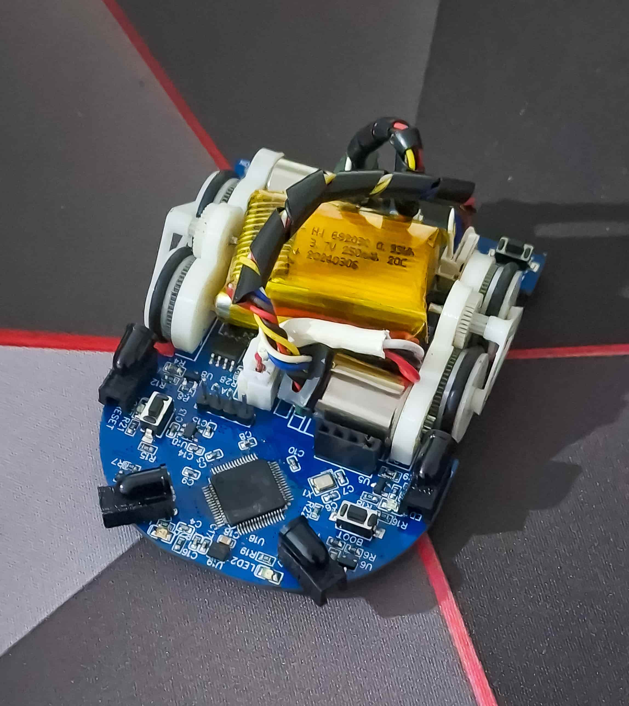
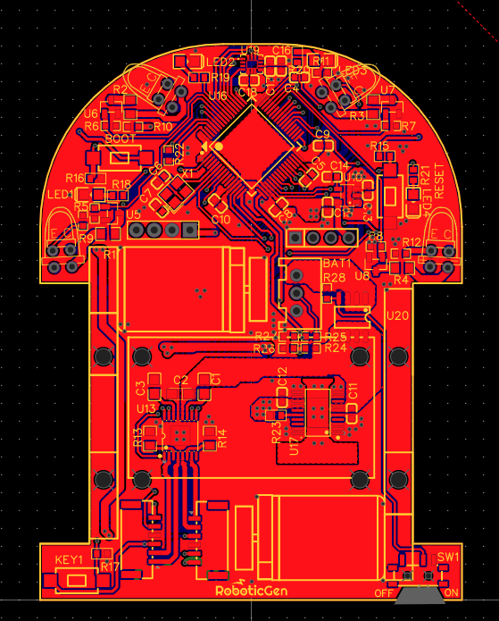
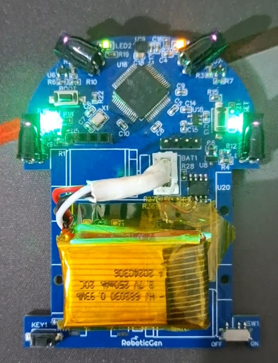
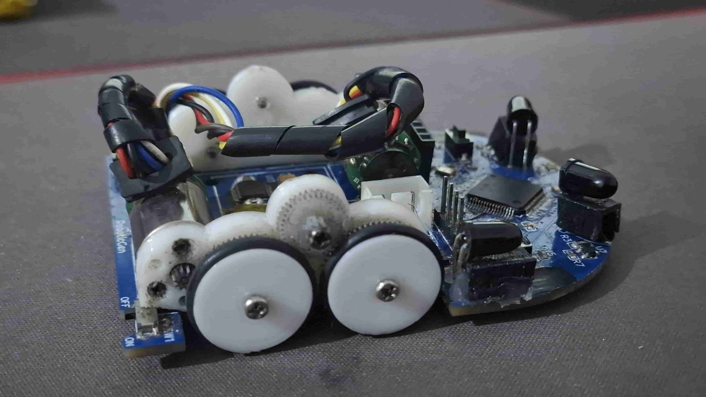

# RGen Mice

RGen Mice is an open-source micromouse: a small autonomous robot that maps an unknown 16 x 16 maze, then finds and runs a fast route to the goal. This repository holds the whole build: the custom PCB (schematic, gerbers and BOM), the SolidWorks drive and chassis models with STL files for 3D printing, the STM32F405 firmware in C/C++, component research with datasheets, and photos of each prototype. Designed and built by Rajinthan Rameshkumar.



## Hardware

| Block | Parts | Notes |
|---|---|---|
| MCU | STM32F405RGT6 (LQFP64) | 25 MHz crystal, PLL to 168 MHz |
| Gyro / IMU | TDK ICM-42688-P | SPI3 (PC10-PC12, CS on PD2). The Z gyro is read at ±2000 dps and integrated every 1 ms for heading |
| Wall sensors | 4 x SFH4545 IR emitters, 4 x TEFT4300 phototransistors | Front-left, left, right and front-right. Each emitter is switched by an AO3400A MOSFET; the receivers go to ADC1 |
| Motors | 2 x 1215 coreless motors with magnetic quadrature encoders | Encoders on TIM1 (PA8/PA9) and TIM2 (PA0/PA1) in encoder mode |
| Motor driver | TI DRV8833 | Four PWM channels from TIM3 (12-bit), enable on PB2, nFAULT on PC4 |
| Power | 2S LiPo, TPS76850 (5 V) and TPS73633 (3.3 V) LDOs | Both cell voltages are measured by the ADC (PA2, PA3) |
| User interface | 4 LEDs, two buttons (KEY, BOOT), reset, power switch | USART1 (PB6/PB7) at 115200 baud for debugging, SWD for programming |

The PCB is a two-layer board drawn in EasyEDA and branded RoboticGen on the silkscreen. The drive puts two wheels on each side, geared to one motor, with the larger gears taken from MG996R servos, the motor pinions from SG90 servos, and O-rings as tyres; the rims, motor holders and washers are 3D printed.

| PCB layout | Assembled board | Drive assembly |
|---|---|---|
|  |  |  |

## Firmware

The firmware is an STM32CubeIDE project for the STM32 HAL. CubeMX generates `Core/Src/main.c`, which hands over to `core()` once the peripherals are set up. The application itself is C++ and lives in `Firmware/Core/Drivers/`. The `Motion`, `Profile` and `Maze` classes follow the structure of the UKMARS mazerunner-core code (`motion.h` still refers to UKMARSBOT); the hardware layer, the control loops, the turn set and the path planner were written or adapted for this robot.

**Control loop.** SysTick runs at 1 kHz. While the mouse is enabled, each tick:

1. integrates the gyro to get the heading;
2. reads the four IR sensors, taking a dark reading and then a lit reading 80 µs after each emitter turns on, to cancel ambient light;
3. checks for a collision: if the heading error stays above 20°, the motors are switched off;
4. measures both battery cells;
5. advances the forward and rotation speed profiles;
6. runs the closed-loop drive update.

The drive update has two PID controllers. The position controller compares the profiled distance with the encoder distance. The angle controller compares the profiled heading with the gyro heading, and wall-following steering and front-wall alignment are added to its target. The two outputs are summed and differenced into left and right PWM. The driver brakes for a moment on each change of direction; this was the fix for DRV8833 over-current trips during development.

| Module (`Core/Drivers/Src`, `Inc`) | Role |
|---|---|
| `core.cpp` | Start-up, button menu, run-mode selection, 1 kHz `systick()` task |
| `mouse.h` | Search, fast run and planned runs; in-place, smooth and diagonal turns; map updates from the wall sensors |
| `maze.cpp` / `maze.h` | 16 x 16 wall map (exit, wall, unknown, virtual), flood fill, flash save/load |
| `motion.h`, `profile.h` | Trapezoidal speed profiles for forward and rotary motion |
| `drive.cpp` | Position and angle PID, PWM output, motor enable |
| `sensor.cpp`, `wall_handle.cpp` | IR sampling and distance estimate, low-pass filter, wall detection, steering and front-wall error, IR calibration |
| `icm.cpp`, `encoder.cpp`, `adc.cpp` | ICM-42688 over SPI with gyro offset calibration, encoder counts, ADC reads |
| `flash.cpp` | Stores the IR calibration and the maze map in flash sector 7 (0x08060000) |
| `usart.cpp` | Interrupt-driven serial command console and maze printing |

**Maze solving.**
- **Search run:** the mouse floods the maze from the goal, and at each cell it updates the walls and re-floods before choosing the neighbour with the lowest cost. It drives to the goal and back home, saving the map to flash each time it reaches its target.
- **Fast run:** floods only through cells that have been visited.
- **Optimised run:** plans the whole path in advance from the stored map, merges consecutive straights into one profiled move and then runs it.
- **Diagonal run:** additionally turns alternating left/right sequences into 45° entries, diagonal straights and 45° exits.

On every run type, turns can be in-place or smooth, and the gyro can correct the turn angle.

**Operation.**
- Hold KEY during reset to calibrate the IR sensors against the walls; the readings are stored in flash.
- Press BOOT to arm a run, then choose the mode:
  - cover the front-left sensor for a search run;
  - cover the front-right sensor for a fast run;
  - press KEY for an optimised run;
  - press BOOT again for an optimised diagonal run.
- Press KEY while idle to open the settings. Turning the left wheel changes the search speed (100-1000 mm/s, shown on the LEDs). Turning the right wheel switches smooth turns on or off. BOOT enables gyro-corrected turns.
- The goal cell is `GOAL` in `core.cpp`, or can be set over serial with `set_goal=(x,y)`.
- Send `help` on the serial console (115200 8N1) for the command list: motion tests, sensor readout, printing the map with costs, and saving and loading the maze.

## Building and flashing

The CubeMX-generated HAL drivers (`Firmware/Drivers/`) and the Eclipse project files (`.project`, `.cproject`, `.mxproject`) are listed in `.gitignore`, so a fresh clone does not build as-is. To recreate them:

1. Install STM32CubeIDE, or STM32CubeMX 6.15 or later with the STM32Cube FW_F4 V1.28.2 package. The `.ioc` was saved with these versions.
2. Open `Firmware/Mice_Firmware.ioc` in STM32CubeMX (or in CubeIDE's device configuration tool) and run **Generate Code**. The project is set to the STM32CubeIDE toolchain, with project files in `Firmware/` itself, and to keep user code, so this adds `Drivers/` and the project files without touching the code between the `USER CODE` markers.
3. In STM32CubeIDE, use **File > Import > Existing Projects into Workspace** and select `Firmware/`.
4. The application is C++: if the project is not already a C++ project, right-click it and choose **Convert to C++**. Add `Core/Drivers/Inc` to the include paths of both the C and C++ compilers.
5. Build, connect an ST-Link to the SWD pins and use **Run > Debug As > STM32 C/C++ Application**. `Firmware/Mice_Firmware Debug.launch` is the debug configuration used during development.

## Repository layout

```text
Design/      SolidWorks assemblies and parts (mouse, drive system, 1215 motor model,
             gears, rims, tyres), drawings and DXFs; STL files for printing in prints/
Firmware/    STM32CubeIDE project: Mice_Firmware.ioc, linker scripts, Core/
             (CubeMX code in Src/ and Inc/, application code in Drivers/)
Images/      Photos and renders: prototypes, PCB, drive assembly, reference designs
PCB/         Schematic (micromouse.pdf), BOM.csv and gerbers/ ready for fabrication
Research/    Component trade-offs (Components.txt), encoder calculations (Log.txt),
             references, Datasheets/ and Progress/ (prototype photos and videos)
Simulation/  sim1.cpp, a small terminal maze renderer, and a README with the
             drive assembly guide
```

## Simulation

`Simulation/sim1.cpp` is a minimal C++ program that draws a 16 x 16 maze and the mouse's position in the terminal. It is a starting point for testing maze logic off the robot, not a physics simulator. [`Simulation/README.md`](Simulation/README.md) holds an earlier write-up of the project, including the step-by-step drive system assembly.

## Development history

From the commit log and the progress photos:

- **Apr-Jun 2025:** surveyed MCUs, IR parts, IMUs, motor drivers and motors (`Research/Components.txt`) and fixed the component choice. Built three drive prototypes, ending with two geared wheels per side: [V1](Images/Prototype_V1_2.jpg), [V2](Images/PrototypeV2_3.jpg), [V3](Images/PrototypeV3_3.jpg). Videos: [V1](Research/Progress/Prototype_V1_3.mp4), [V3](Research/Progress/Prototype_V3_1.mp4). Designed the PCB in June.
- **Aug 2025:** imported the firmware, got the gyro reading live and assembled the [finished mouse](Images/Final.jpg).
- **Sep 2025:** added closed-loop speed and angular-speed control, wall following, front-wall alignment, speed profiles and the gyro drift fix. The first maze solving followed, then a full search run with return to home. The motor driver's over-current trips were traced to current spikes and resolved.
- **Oct 2025:** added the button menu and smooth turns. The commit log records fast runs at 400 mm/s and then 500 mm/s. Added gyro-based turns, the planned path with straight merging, the IR low-pass filter, and finally diagonal runs.

## References

- [UKMARS](https://ukmars.org/) and the UKMARSBOT mazerunner code
- [Micromouse Online](https://micromouseonline.com/), including [the article on speed profiles](https://micromouseonline.com/2017/08/03/micromouse-hard-acceleration/) and [the one on sensor design](https://micromouseonline.com/2015/11/03/zeetah-sensor-design/)
- The Green Giant micromouse, used as a design reference (`Images/Green_Giant.png`)
